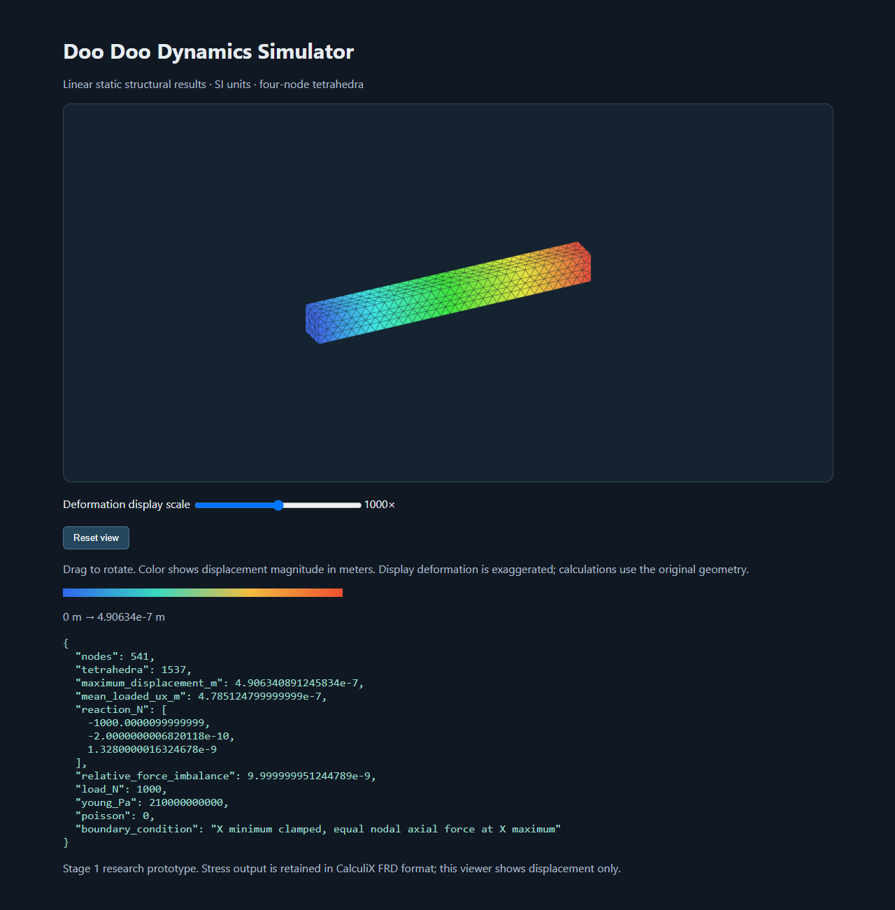

# Doo Doo Dynamics Simulator

An independent, open-source simulation platform being built in stages. The first stage runs a complete CAD → Gmsh tetrahedral mesh → CalculiX linear static solve → displacement viewer workflow.

**Desktop app and MCP controls:** install with `tools/install-desktop.ps1`, then double-click **Launch Simulator.cmd**. The workbench includes a ribbon, model tree, properties, viewport and solver jobs. Planned features are visibly greyed out. See [desktop and MCP setup](docs/DESKTOP_AND_MCP.md).



## Working now

- Import one closed STEP, IGES or BREP solid using Gmsh's OpenCASCADE kernel.
- Generate linear four-node tetrahedra, reject invalid volume elements and export a mesh.
- Clamp the X-minimum face and distribute a total axial force equally over X-maximum nodes.
- Solve isotropic linear elasticity through the external CalculiX executable; verify completion, displacement completeness and reaction equilibrium.
- Export an offline, rotatable HTML displacement viewer, VTK displacement data and native CalculiX stress/displacement FRD files.
- Record CAD, input-deck and solver hashes, material properties, mesh settings and dependency versions per run.

This is a research prototype. Stage 1 supports one material, one solid and the specific boundary condition above. Equal nodal forces are not uniform surface traction. Curved end faces, assemblies, contact, nonlinear behavior and arbitrary load directions need later stages. C3D4 elements require mesh-convergence checks, especially for bending and nearly incompressible materials. No Ansys compatibility or accuracy equivalence is claimed.

## Run locally on Windows

This checkout already has a project environment and CalculiX installed. From the project directory:

```powershell
.\.venv\Scripts\open-sim.exe doctor
.\.venv\Scripts\open-sim.exe example examples\my-bar.step
.\.venv\Scripts\open-sim.exe solve examples\my-bar.step --out runs\my-bar
Start-Process .\runs\my-bar\results.html
.\.venv\Scripts\python.exe -m pytest -q
```

The supplied `examples/axial-bar.step` is a generated 1 × 0.1 × 0.1 bar. Use a new output folder for each run; existing run folders are deliberately preserved. Failed runs retain their input/log files and should be inspected before retrying into a new folder.

### Fresh installation

Install Python 3.12 x64 from its official distribution, then:

```powershell
.\tools\setup.ps1 -Python 'C:\path\to\python.exe'
```

The setup script installs wheel-only, hash-checked packages from PyPI and downloads the pinned Windows archive linked by the CalculiX author. It runs only `ccx_static.exe` with SPOOLES; no optional MKL installation is required. The script does not register REA with any coding assistant.

On another operating system or Python version, create a virtual environment, install `.[dev]`, and separately install CalculiX from a trusted distribution. The Windows/Python 3.12 hash lock does not apply to other platforms. Set `CCX_EXECUTABLE` to your solver path, or put `ccx` on PATH. Those configurations have not been validated here.

### Import your own model

```powershell
.\.venv\Scripts\open-sim.exe solve part.step --cad-scale 0.001 --mesh-size 0.005 --young 210000000000 --poisson 0.3 --load 1000 --out runs\part-01
```

All solver quantities use meters, newtons and pascals. `--cad-scale` multiplies coordinates returned by the CAD importer; inspect the resulting mesh dimensions because CAD exporters and import kernels can normalize units. For a file whose imported numerical coordinates are millimeters, use `0.001`. The example's default Poisson ratio is zero to make the analytical axial benchmark simple; choose the appropriate material properties for real models.

## Verification

Tests exercise CAD import and scaling, surface extraction, material validation, malformed results, subprocess failures/timeouts and real Gmsh/CalculiX solves on two mesh densities. They compare mean axial displacement against `F L / (E A)` and check force balance. Solver integration tests skip explicitly when CalculiX is absent; a skip is not solver validation. See [validation evidence](docs/VALIDATION.md).

## Development and provenance

The Python package is under `src/opensim`; the command is `open-sim`. Keep meshing, solver-deck generation, execution and visualization separate. See the [roadmap](docs/ROADMAP.md), [clean-room policy](docs/CLEAN_ROOM.md), [dependency review](docs/DEPENDENCIES.md) and [REA review](docs/REA_REVIEW.md).

Original project code is offered under GPL-2.0-or-later; see [LICENSE](LICENSE). Dependencies retain their own licenses. Installed environments, downloaded executables and generated run artifacts are excluded from Git. Ansys is a third-party trademark; this project is independent and unaffiliated.
