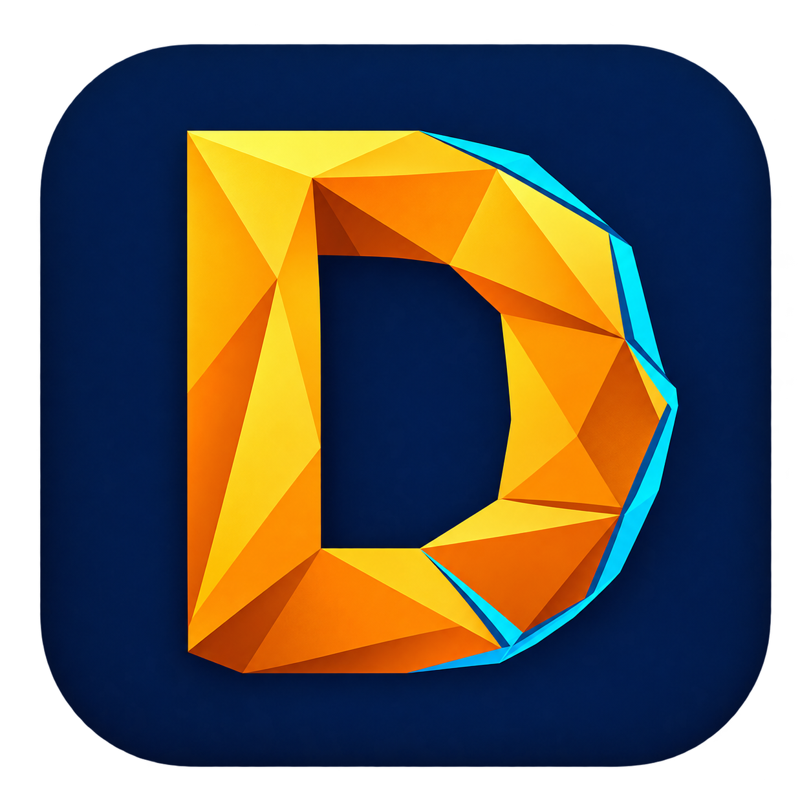

# Doo Doo Dynamics Simulator



An independent, open-source simulation platform being built in stages. The first stage runs a complete CAD → Gmsh tetrahedral mesh → CalculiX linear static solve → displacement viewer workflow.

**Desktop app and MCP controls:** install with `tools/install-desktop.ps1`, then double-click **Launch Simulator.cmd**. The workbench includes a ribbon, model tree, properties, viewport and solver jobs. Planned features are visibly greyed out. See [desktop and MCP setup](docs/DESKTOP_AND_MCP.md).

**Dark mode is the default**, with a persistent Light/Dark toggle in the header and View menu. The viewport follows the selected theme. The Geometry/Validation ribbons include a quadratic cantilever preset.

**Cat mode:** toggle **Cat mode** in the top bar or View menu for an original joke translation. Solve becomes “Do a science, meow,” modal analysis becomes “Find da wiggles,” and density becomes “Chonk density.” It remembers your choice and switches straight back to English. Numbers, units, project names, model inputs and solver data stay intact. [Preview and details](docs/CAT_MODE.md).

The title occupies the top menu bar, and the viewport now uses batched WebGL rendering with pan/zoom controls and a Canvas fallback. The same-beam browser benchmark improved from about 11 to 144 FPS; see [measurement details](docs/VIEWPORT_PERFORMANCE.md).

**Beam verification:** the [Euler–Bernoulli cantilever study](docs/cantilever/REPORT.md) gives 0.139% tip-section displacement error and a 0.0135% last-mesh change for the C3D10 model. Its C3D4 baseline underpredicts deflection by 50.8% at the tested mesh; element choice matters.

**Hole stress verification:** the [thin-plate circular-hole study](docs/hole/REPORT.md) gives a gross stress concentration factor of **3.002**, versus Kirsch's **3** (0.067% error). Three quadratic plane-stress meshes and a doubled-domain check separate mesh and finite-plate effects. The dedicated plane-stress benchmark is separate from the general solid workflow.

**Timoshenko verification:** the [thin-beam and shear-control study](docs/timoshenko/REPORT.md) compares nine independent 3D solves with bending-plus-shear theory. The thin beam differs by 0.1701%; a shorter zero-Poisson control differs by 0.0329% and recovers 98.59% of the theoretical shear increment. A retained short ν=0.3 study documents clamp effects. Open the Timoshenko and circular-hole reports from the desktop Validation ribbon.

**Modal analysis:** extract 1–30 natural frequencies and normalized mode shapes from the desktop **Modal analysis** button, CLI or MCP. Enter density in kg/m³, choose quadratic elements for bending, solve and select a mode to animate. The [modal beam study](docs/modal/REPORT.md) validates six bending frequencies within 0.402% of theory, plus shapes, mesh stability and density scaling. See [modal setup and limits](docs/MODAL.md).

**Distributed loads:** choose **Uniform surface traction**, a bounding-plane surface and X/Y/Z direction, then enter the **total force in N**. The solver integrates that force consistently over the selected surface. The [uniformly loaded beam study](docs/distributed/REPORT.md) gives 0.1784% tip-deflection error and 0.0202% last-mesh change. See [load setup and scope](docs/DISTRIBUTED_LOADS.md).

**Selected regions and stress:** **Support / load regions…** accepts CAD face IDs and an optional coordinate box. Selected supports are fully fixed; loads can use global X/Y/Z traction or [perpendicular inward/outward forces](docs/NORMAL_LOADS.md). New static solves offer recovered **von Mises stress** in MPa alongside displacement. See [setup, unit conversion and limitations](docs/SURFACE_REGIONS.md). The properties panel wraps its text and keeps input controls inside narrow docks in both languages.


## Working now

- Study branches for static, modal and convergence analysis, with a lower settings panel that follows the selected study. See [study panels](docs/STUDY_PANELS.md).
- Open only the projects you need, search the saved library, rename projects and locate their model/run files from the desktop. See [project navigation](docs/PROJECT_NAVIGATION.md).
- Import one closed STEP, IGES or BREP solid using Gmsh's OpenCASCADE kernel, or a watertight STL, OBJ or 3MF mesh (rebuilt into a solid with pickable face patches).
- Generate linear C3D4 or quadratic C3D10 tetrahedra, check corner-element orientation and export a mesh.
- Clamp the X-minimum face and apply an X/Y/Z force at a tip-center node, through the legacy equal-node X-max load, or as uniform traction integrated over a selected X/Y/Z min/max boundary surface.
- Solve isotropic linear elasticity through CalculiX; verify completion, displacement completeness, force balance and moment balance.
- Export an offline, rotatable HTML displacement viewer, VTK displacement data and native CalculiX stress/displacement FRD files.
- Record CAD, input-deck and solver hashes, material properties, mesh settings and dependency versions per run.
- Run a mesh convergence study: repeat the static solve on finer meshes with per-quantity change, verdict, Richardson extrapolation and GCI, stopping early when converged.
- Extract undamped, unprestressed natural frequencies with the X-min face fixed, export every mode as HTML/VTK and retain raw eigenvectors. Animate normalized shapes with arbitrary display amplitude and 1 Hz playback.

This is a research prototype. It supports one material, one solid and the fixed-support/load conditions above. The legacy equal-node load and consistent uniform traction are separate choices. Point loading requires an end face containing the bounding-section center. The desktop supports [clicking CAD faces](docs/SURFACE_REGIONS.md) for fully fixed supports and uniformly distributed forces. Assemblies, contact, nonlinear behavior and more general support types need later stages. Prefer C3D10 for bending and perform mesh-convergence checks. A point load has a local stress singularity; the cantilever studies validate global displacement and equilibrium, not arbitrary peak stresses. No Ansys compatibility or accuracy equivalence is claimed.

## Run locally on Windows

This checkout already has a project environment and CalculiX installed. From the project directory:

```powershell
.\.venv\Scripts\open-sim.exe doctor
.\.venv\Scripts\open-sim.exe example examples\my-bar.step
.\.venv\Scripts\open-sim.exe solve examples\my-bar.step --out runs\my-bar
Start-Process .\runs\my-bar\results.html
.\.venv\Scripts\python.exe -m pytest -q
.\.venv\Scripts\open-sim.exe validate-cantilever --out runs\beam-validation
.\.venv\Scripts\open-sim.exe validate-hole --out runs\hole-validation
.\.venv\Scripts\open-sim.exe validate-timoshenko --out runs\timoshenko-validation
.\.venv\Scripts\open-sim.exe modal examples\my-bar.step --mesh-size 0.02 --density 7850 --modes 6 --out runs\modal-bar
.\.venv\Scripts\open-sim.exe validate-modal --out runs\modal-validation
.\.venv\Scripts\open-sim.exe validate-distributed --out runs\distributed-validation
```

The supplied `examples/axial-bar.step` is a generated 1 × 0.1 × 0.1 bar. Use a new output folder for each run; existing run folders are deliberately preserved. Failed runs retain their input/log files and should be inspected before retrying into a new folder.

### Fresh installation

Install Python 3.12 x64 from its official distribution, then:

```powershell
.\tools\setup.ps1 -Python 'C:\path\to\python.exe'
```

The setup script installs wheel-only, hash-checked packages from PyPI and downloads the pinned Windows archive linked by the CalculiX author. It runs only `ccx_static.exe` with SPOOLES; no optional MKL installation is required. The script does not register REA with any coding assistant.

On another operating system or Python version, create a virtual environment, install `.[dev]`, and separately install CalculiX from a trusted distribution. The Windows/Python 3.12 hash lock does not apply to other platforms. Set `CCX_EXECUTABLE` to your solver path, or put `ccx` on PATH. Those configurations have not been validated here.

### Import your own model

```powershell
.\.venv\Scripts\open-sim.exe solve part.step --cad-scale 0.001 --mesh-size 0.005 --young 210000000000 --poisson 0.3 --load 1000 --out runs\part-01
```

Application inputs and processed results use meters, newtons and pascals. Selected-region runs use an equivalent native N–mm–MPa solver deck, recorded in the manifest; raw DAT/FRD units follow that deck. `--cad-scale` multiplies coordinates returned by the CAD importer; inspect the resulting mesh dimensions because CAD exporters and import kernels can normalize units. For a file whose imported numerical coordinates are millimeters, use `0.001`. The example's default Poisson ratio is zero to make the analytical axial benchmark simple; choose the appropriate material properties for real models.

For the supplied cantilever geometry, use `--order 2 --load-axis z --load-kind point --load -10 --poisson 0.3 --mesh-size 0.0067`. The `validate-cantilever` command creates that 1 × 0.02 × 0.02 m geometry and runs the full mesh study; plotting dependencies are installed by the desktop installer or `pip install '.[validation]'`.

## Verification

Tests exercise CAD import and scaling, surface extraction, material validation, malformed results, subprocess failures/timeouts and real Gmsh/CalculiX solves on two mesh densities. They compare mean axial displacement against `F L / (E A)` and check force balance. Solver integration tests skip explicitly when CalculiX is absent; a skip is not solver validation. See [validation evidence](docs/VALIDATION.md).

## Development and provenance

The Python package is under `src/opensim`; the command is `open-sim`. Keep meshing, solver-deck generation, execution and visualization separate. See the [roadmap](docs/ROADMAP.md), [clean-room policy](docs/CLEAN_ROOM.md), [dependency review](docs/DEPENDENCIES.md) and [REA review](docs/REA_REVIEW.md).

Original project code is offered under GPL-2.0-or-later; see [LICENSE](LICENSE). Dependencies retain their own licenses. Installed environments, downloaded executables and generated run artifacts are excluded from Git. Ansys is a third-party trademark; this project is independent and unaffiliated.
