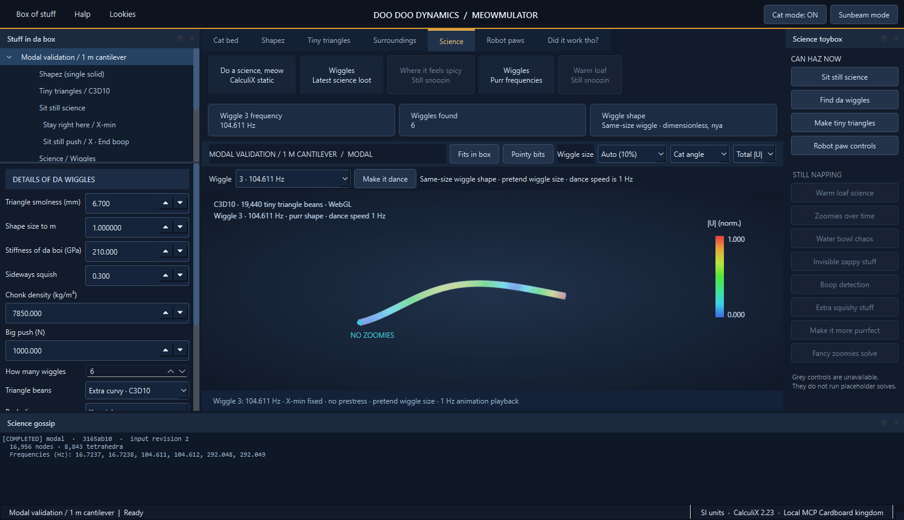

# Cat mode

A deliberately silly feline translation for the native workbench, inspired by joke language options in games. All translation text is original; no Minecraft assets or language files are included.

Use **Cat mode: OFF/ON** in the top bar or **View → Cat mode (joke translation)**. The switch stays labeled in English so you can always find the way back. The preference persists across restarts and synchronizes between current desktop windows sharing the workspace.

| English | Cat mode |
| --- | --- |
| Solve | Do a science, meow |
| Modal analysis | Find da wiggles |
| Density | Chonk density |
| Poisson ratio | Sideways squish |
| Generate mesh | Make tiny triangles |
| Animate mode | Make it dance |
| Fixed viewport marker | NO ZOOMIES |
| Validation | Did it work tho? |

Menus, ribbons, properties, result captions, model-tree labels, toolbox buttons and viewport captions join the joke. User project names, numeric inputs, unit symbols, element identifiers and combo-box values remain unchanged. Disabled features stay disabled. The language choice is a UI preference, not an analysis parameter, and does not invalidate results or change the project revision. Solver diagnostics, exported results and published engineering reports retain their original data and technical text.

Checks cover preserved values and identifiers, saved preference, repeated refreshes, unchanged project state and a round trip back to English. A native desktop check also confirmed that the modal frequency remains 104.6114 Hz and the WebGL viewer keeps its existing geometry buffer while showing feline captions.

The full suite passed 77 tests in 53.74 seconds, with no skips. The focused language and desktop checks also passed after adding an assertion that disabled controls stay disabled.
