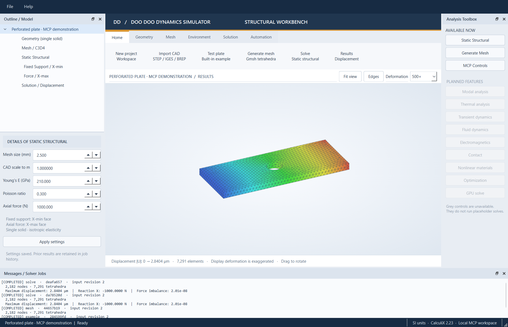

# Desktop workbench and MCP automation

The native Windows desktop application provides an engineering ribbon, model outline, material/load/mesh properties, rotatable viewport, analysis toolbox and job log. It uses original interface code and common engineering-workbench conventions. It contains no Ansys interface assets, source code or branding.



## Install and launch

Use Python 3.12 x64 and run from this checkout:

```powershell
.\tools\install-desktop.ps1 -Python 'C:\path\to\python.exe'
```

Double-click **Launch Simulator.cmd**, or run:

```powershell
.\.venv\Scripts\doo-doo-dynamics.exe
```

This is a locally installed Python/Qt desktop application. It is not yet a self-contained executable installer. The launcher depends on the project's environment and checkout remaining in place.

The desktop/MCP extension uses the official `PySide6==6.10.2` and `mcp==1.26.0` PyPI packages. The Windows/Python 3.12 extension lock includes exact hashes for their transitive wheel dependencies and includes the core lock. Qt/PySide and Chromium retain their upstream license notices; the MCP SDK is MIT. Installed binaries are not committed or redistributed in this source repository.

## Use the desktop

1. Click **Test plate** to create a 100 × 40 × 5 mm solid with a 12 mm through hole, or create a project and import STEP/IGES/BREP.
2. Set mesh size, coordinate scale, Young's modulus, Poisson ratio and total axial load in the details panel; click **Apply settings**.
3. Click **Generate mesh** or **Solve**. Meshing and CalculiX run in a separate process while the UI remains responsive.
4. Select Geometry, Mesh or Solution in the outline. Drag the viewport to rotate; use Fit view, Edges and the deformation display selector.

Project inputs, job statuses and results persist in `workspace/workspace.sqlite3` and per-project folders. The workspace is ignored by Git. Input changes invalidate displayed results without deleting historical job files. Active jobs prevent changes to that project's inputs. Job failure messages and worker/solver logs are retained. Cancelling or recovering interrupted workers is not implemented yet; normal jobs finish independently of the GUI window.

Implemented analysis remains one solid and one isotropic linear material with an X-min clamp and equal nodal X-max axial forces. Planned modal, thermal, transient, CFD, electromagnetic, contact, nonlinear, optimization and GPU features are **disabled controls**, with tooltips saying they are not implemented. The MCP capability catalog reports the same distinction. Geometry mode displays an undeformed tessellated model, not a CAD editor; contour results show displacement only.

## MCP connection

The app exposes a local stdio MCP server. The assistant and desktop use the same workspace database; the desktop refreshes shared changes automatically. No public listener or network credentials are required.

Start manually:

```powershell
.\.venv\Scripts\python.exe -m opensim.mcp_server
```

Both executables accept `--workspace <absolute-folder>` to use another workspace. Configure both sides with the same folder. Use `python.exe`, not `pythonw.exe`, for the stdio server.

For Codex, register the installed server with absolute paths:

```powershell
codex mcp add doo_doo_dynamics -- 'C:\path\to\project\.venv\Scripts\python.exe' -m opensim.mcp_server --workspace 'C:\path\to\project\workspace'
codex mcp get doo_doo_dynamics --json
```

Restart the client or reconnect its MCP servers to discover the new tools. Registration does not inject tools into a conversation already running. This follows the [official MCP configuration documentation](https://developers.openai.com/codex/mcp/).

Other MCP clients can launch the same command using a standard stdio configuration:

```json
{
  "mcpServers": {
    "doo_doo_dynamics": {
      "command": "C:/path/to/project/.venv/Scripts/python.exe",
      "args": ["-m", "opensim.mcp_server", "--workspace", "C:/path/to/project/workspace"]
    }
  }
}
```

### Tools

| Tool | Purpose |
| --- | --- |
| `get_capabilities` | Available/planned features, workspace and desktop heartbeat |
| `list_projects` / `create_project` / `get_project` | Project discovery and creation |
| `import_cad` | Copy an explicitly selected local CAD file into the project |
| `set_analysis_parameters` | Set all five analysis inputs in SI units |
| `create_test_object` | Generate a perforated plate or axial bar as a background job |
| `mesh_project` / `solve_project` | Start asynchronous meshing or static structural solve |
| `get_job` | Poll status, failure or numerical summary |
| `get_results` | Current results and artifact paths; rejects stale inputs |
| `show_in_desktop` | Select project and geometry/mesh/results view |

Typical sequence: create project → set parameters → create/import CAD → wait for meshing → solve → poll job → get results → show in desktop. Each returned job ID identifies a distinct output folder. The server accepts only the implemented job kinds; it does not expose arbitrary command execution or an executable-path override.

## Verified behavior

The full suite passes 26 tests locally, including a real MCP stdio session, parameter validation, disabled UI controls, cross-process workspace jobs, stale-result rejection, malformed-CAD failure and the original structural tests. A separate actual MCP workflow created the perforated plate, generated 7,291 tetrahedra, solved the 1,000 N case and returned maximum displacement **2.8404 µm** before selecting its desktop results view. The screenshot is a capture of the running native Qt app with those results.

The native app was also launched with `pythonw.exe`; invoking its desktop Solve action completed a second real solver job, refreshed the shared job log and displayed the same numerical result. The Codex registration was added and verified on the development machine; an already-running chat must reconnect or restart to discover the new server.
