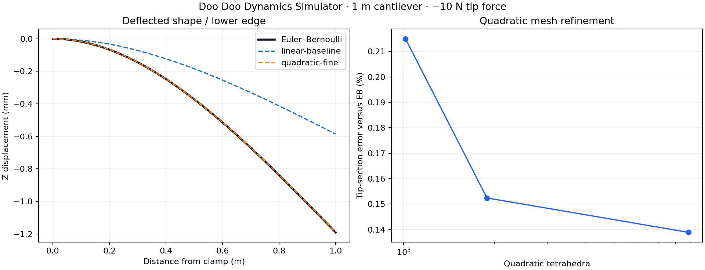

# Long cantilever validation

**PASS** — Euler–Bernoulli displacement comparison.

1,000 × 20 × 20 mm beam; E=210 GPa, ν=0.3; full clamp at X=0; a single −10 N Z force at (1, 0.01, 0.01) m.

I = 1.333333333e-08 m⁴. Analytical tip w = −1.190476190 mm; reaction Z=10 N; root moment Y=−10 N·m.

| Element / mesh | Elements | Tip mean Z (mm) | Error vs EB |
|---|---:|---:|---:|
| linear-baseline (10 mm) | 1,891 | -0.585906 | 50.7839% |
| quadratic-coarse (20 mm) | 1,014 | -1.187917 | 0.2150% |
| quadratic-medium (10 mm) | 1,891 | -1.188661 | 0.1524% |
| quadratic-fine (6.7 mm) | 8,843 | -1.188823 | 0.1389% |

Last quadratic mesh change: **0.0135%**. Fine-mesh force imbalance: 1.369e-06; moment imbalance: 1.304e-08.

Acceptance was specified as <2% tip and normalized curve error, <0.5% last-mesh change and <1e−5 equilibrium residuals.

The linear-tetrahedron baseline is retained to expose its bending stiffness error. It is not included in the quadratic acceptance result.

A mathematical 3D point load has a local singularity. The area-averaged tip section and a longitudinal edge curve away from the load point are the comparison quantities; no point-stress convergence claim is made. The plotted edge is at Y=Z=0. The solid root is fully clamped and includes Poisson constraint; Euler–Bernoulli theory omits 3D end effects and transverse shear. Estimated shear deflection is 0.000371 mm, or 0.0312% of the EB bending deflection.

References: [CalculiX element guidance](https://www.dhondt.de/ccx_2.23.pdf), [Gmsh node ordering](https://gmsh.info/doc/texinfo/#Node-ordering), [University of Alberta beam theory](https://engcourses-uofa.ca/books/introduction-to-solid-mechanics/plane-beam-approximations/euler-bernoulli-beam/).
