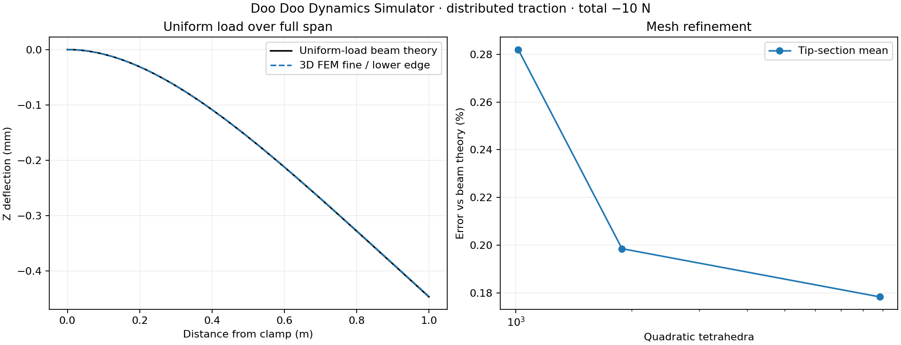

# Distributed-load validation

**PASS** — uniform surface traction, equivalent nodal loading and real solver studies.

The load input is the signed **total force in N**, not Pa or N/m. The selected surface area is measured from the boundary mesh; constant traction is F/A in the selected global X/Y/Z direction. Planar bounding surfaces X/Y/Z min/max are available. The legacy equal-node end load is retained separately and is not called uniform traction.

Beam: 1,000 × 20 × 20 mm, E=210 GPa, ν=0.3, X-min fully fixed. A total −10 N Z force is distributed on Z-max: area 0.02 m², traction −500 Pa, equivalent line load q=−10 N/m. Euler–Bernoulli predicts `w(x)=q*x²*(6L²−4Lx+x²)/(24EI)` and `w(L)=qL⁴/(8EI)`; I=bh³/12. Expected root reaction is +10 N Z and −5 N·m Y.

| Quadratic mesh | Elements | Tip mean Z (mm) | Error vs theory |
|---|---:|---:|---:|
| coarse | 1,015 | -0.445169900 | 0.2819% |
| medium | 1,889 | -0.445542000 | 0.1986% |
| fine | 8,843 | -0.445632043 | 0.1784% |

Analytical tip: **-0.446428571 mm**. Last mesh change: **0.0202%**. Fine edge-curve error normalized by analytical tip deflection: **0.1784%**.

The axial traction patch check uses a 1 × 0.1 × 0.1 m bar, E=210 GPa, ν=0, F=1,000 N at X-max. Uniform stress gives `u=FL/(EA)`. Two quadratic mesh densities are checked against a 0.001% error limit.

| Axial mesh | FEM tip X (m) | Relative error (%) |
|---|---:|---:|
| axial-coarse | 4.761905e-07 | 0.0000050% |
| axial-fine | 4.761905e-07 | 0.0000050% |

Uniform vector traction F/A: P1 triangle nodal forces A*t/3; P2 straight triangle corner forces zero, midside forces A*t/3. Shared-node contributions are accumulated.

CalculiX RF at a support includes CLOAD there; true reaction is RF minus applied nodal force. Moments use every applied nodal force at its actual coordinate.

On the fine beam mesh, applied force at the constrained edge is -0.00858200794 N. Reported support RF sums to 9.99142022 N; the recovered physical support reaction is 10.0000022 N. Omitting this correction would fail equilibrium.

Acceptance: beam tip and normalized edge curve <2%, last-mesh change <0.5%, axial errors <0.001%, every force/moment residual <1e−5. Unit tests also check all six surface choices in all three vector directions, reversal/scaling, exact quadratic virtual work and malformed surface rejection.

Single constant traction vector on one axis-aligned bounding-plane boundary patch. Not arbitrary face picking, pressure, follower loading or spatially varying loading. Beam theory neglects shear and 3D end effects; global displacement and equilibrium are validated, not local root peak stress.

Reproduce: `open-sim validate-distributed --out <new-folder>`. Raw meshes, decks, logs, DAT/FRD, viewers and nodal forces are retained per case.

References: [TU Graz cantilever under uniform load](https://lampz.tugraz.at/~hadley/memm/mechanics/cbeam.php), [LUSAS consistent equivalent nodal force theory](https://www.lusas.com/user_area/theory/equivalent_force_distribution.html), [CalculiX RF definition](https://www.dhondt.de/ccx_2.23.pdf).
