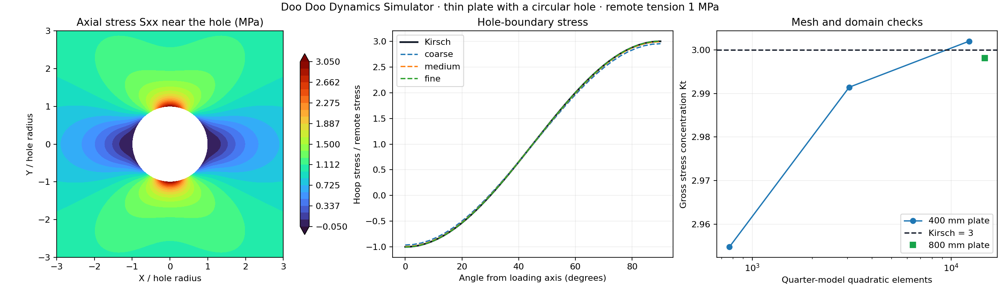

# Circular-hole stress-concentration validation

**PASS** — Kirsch stress concentration comparison.

Main plate: 400 × 400 × 0.1 mm with a centered 10 mm through-hole. E=210 GPa, ν=0.3. Remote tensile stress is 1 MPa in X, applied as consistent quadratic-edge traction loads. The full-plate tensile force is 40 N; the quarter-model loaded edge carries 20 N.

A quarter model uses Ux=0 on X=0 and Uy=0 on Y=0, with free hole and outer top boundaries. These are symmetry constraints, not a clamped end. Only constrained reaction components are included in force/moment balance.

Kirsch predicts σθθ(a,θ)=σ∞[1−2cos(2θ)], with a maximum 3σ∞ at θ=90° and 270°. Thus Kt=σθθ,max/σ∞=3, normalized by gross remote stress. The minimum hoop stress is −σ∞ at θ=0°/180°.

| Mesh/domain | Elements | Peak hoop (MPa) | Kt gross | Error vs 3 |
|---|---:|---:|---:|---:|
| coarse | 768 | 2.954750 | 2.954750 | 1.5083% |
| medium | 3,072 | 2.991440 | 2.991440 | 0.2853% |
| fine | 12,288 | 3.002000 | 3.002000 | 0.0667% |
| larger-domain | 14,720 | 2.998090 | 2.998090 | 0.0637% |

Final mesh change: **0.3518%**. Doubling plate width and length to 800 mm changes Kt by **0.1304%**. The larger-domain radial count is increased to preserve approximately the same first-cell size at the hole.

Main fine peak: **3.002000 MPa**, at **90.0°**. Kt based on net-section nominal stress is 2.926950; it must not be compared directly with the gross-stress value 3. Net nominal stress is σ∞/(1−d/W).

Eight-node quadratic CPS8R elements use curved circle midside nodes and geometric radial grading. Stress is read from CalculiX FRD OUTPUT=2D, preserving the global stress tensor component order. Boundary hoop stress is recovered from Sxx, Syy and Sxy. Nodal recovery/averaging is explicitly part of the measurement; integration-point stresses are not mislabeled as the hole-boundary peak.

The hole is smooth and traction-free; unlike a point load, it has a finite elastic stress concentration. Finite-width effects and stress recovery error are distinguished by mesh and domain studies. Acceptance uses <1% reference/curve error, <0.5% mesh/domain change, <1% recovered radial traction relative to σ∞, and <1e−5 force/moment residuals. The angular curve error is normalized by 3σ∞, avoiding division by the zero crossing of hoop stress.

Reproduce: `open-sim validate-hole --out <new-output-folder>`. Raw decks, meshes, logs, DAT/FRD, nodal tensors and boundary CSV samples are retained per case. This dedicated plane-stress benchmark does not replace the general 3D-solid analysis path.

References: [MIT OpenCourseWare, linear elastic stress concentration, pp. 4–8](https://ocw.mit.edu/courses/2-002-mechanics-and-materials-ii-spring-2004/09e8137971e754b1b7290a33a100bb05_lab_4_s04.pdf), [CalculiX CPS8R and OUTPUT=2D documentation](https://www.dhondt.de/ccx_2.23.pdf).
