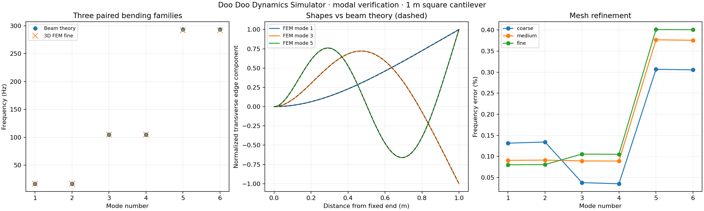

# Modal beam validation

**PASS** — undamped, unprestressed free vibration.

1,000 × 20 × 20 mm solid cantilever; E=210 GPa, ν=0.3, density 7,850 kg/m³. The X-min face is fully fixed. There are no applied loads, damping or prestress. CalculiX solves the generalized eigenproblem Kφ=ω²Mφ using C3D10 tetrahedra and consistent mass.

Reference: `f_n=β_n²/(2πL²) √(EI/(ρA))`, where `cos(β_n)cosh(β_n)=−1`. The first roots are 1.875104069, 4.694091133 and 7.854757438. A square cross-section produces two nearly equal-frequency bending modes per family; their orientation and sign may rotate or swap between meshes.

| Mode | Beam theory (Hz) | Fine FEM (Hz) | Error | Edge-shape MAC |
|---|---:|---:|---:|---:|
| 1 | 16.710332 | 16.723710 | 0.0801% | 0.9999999 |
| 2 | 16.710332 | 16.723800 | 0.0806% | 0.9999999 |
| 3 | 104.721862 | 104.611400 | 0.1055% | 0.9999992 |
| 4 | 104.721862 | 104.611900 | 0.1050% | 0.9999999 |
| 5 | 293.224247 | 292.048000 | 0.4011% | 0.9999976 |
| 6 | 293.224247 | 292.049400 | 0.4007% | 0.9999974 |

Largest last-mesh frequency change: **0.0251%**. Quadrupling density on the identical medium mesh halves every frequency; maximum deviation from that scaling: **0.000038%**.

| Mesh | Quadratic elements | First frequency (Hz) | Sixth frequency (Hz) |
|---|---:|---:|---:|
| coarse | 1,015 | 16.732290 | 292.328700 |
| medium | 1,889 | 16.725470 | 292.122800 |
| fine | 8,843 | 16.723710 | 292.049400 |
| density-scaling | 1,889 | 8.362737 | 146.061400 |

Acceptance: every frequency within 2% of beam theory, every last-mesh frequency change below 0.5%, density scaling error below 0.01%, every edge-shape MAC above 0.995, and fixed-node normalized components below 1e−8. These are benchmark regression limits, not universal error bounds.

Displayed modes are each normalized to maximum nodal vector magnitude 1. Their amplitude is dimensionless and arbitrary; they are not static displacement predictions. Animation plays at 1 Hz for inspection regardless of the actual natural frequency. Raw solver eigenvectors are retained separately. Linear tetrahedra are available but quadratic elements are recommended for bending.

Euler–Bernoulli slender-beam approximation versus 3D clamp, shear and rotary inertia. Square section gives paired bending modes whose orientation/sign is arbitrary. MAC compares the dominant transverse component along a corner edge with the corresponding longitudinal beam shape, not a full mass-weighted 3D MAC. No stiffness/mass residual check or forced-response validation is claimed.

Reproduce: `open-sim validate-modal --out <new-folder>`. Each solve retains its deck, mesh, DAT/FRD, mode HTML/VTK files, raw and normalized vectors, and solver/input hashes. No additional dependencies were installed.

References: [TU Graz cantilever beam frequencies and shapes](https://lampz.tugraz.at/~hadley/memm/mechanics/cbeam.php), [CalculiX 2.23 manual, frequency analysis and *FREQUENCY](https://www.dhondt.de/ccx_2.23.pdf).
