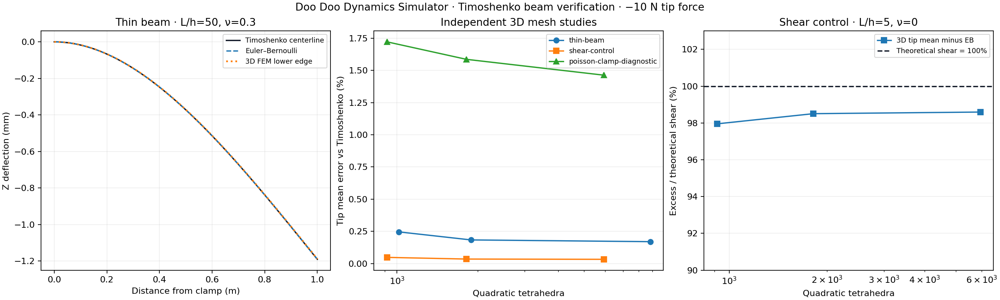

# Timoshenko beam validation

**PASS** — independent CalculiX C3D10 solid comparison.

Each beam has a 20 × 20 mm rectangular section, E=210 GPa and a −10 N tip-center Z force. The X=0 face is fully clamped. All quantities use SI units. The comparison uses area-averaged tip-section displacement, not the singular loaded-node displacement.

Timoshenko: `w(x)=F*x²*(3L−x)/(6EI)+F*x/(κGA)`, with `A=bh`, `I=bh³/12`, `G=E/[2(1+ν)]` and the conventional rectangular-section shear factor `κ=5/6`. The first term is Euler–Bernoulli bending; the second is transverse shear. This formula supplies the reference only; the numerical solutions use independent 3D solid elements.

The thin beam is 1,000 mm long (L/h=50), ν=0.3. A separate 100 mm beam (L/h=5), ν=0, isolates shear more clearly by reducing Poisson restraint at the full clamp. A third study retains ν=0.3 on the 100 mm beam to expose the effect of 3D end conditions. The zero-Poisson material is a controlled verification case, not an assumed steel property.

| Study | Bending tip (mm) | Shear tip (mm) | Timoshenko tip (mm) | Fine FEM mean (mm) | Error |
|---|---:|---:|---:|---:|---:|
| thin-beam | -1.190476190 | -0.000371429 | -1.190847619 | -1.188822551 | 0.1701% |
| shear-control | -0.001190476 | -0.000028571 | -0.001219048 | -0.001218646 | 0.0329% |
| poisson-clamp-diagnostic | -0.001190476 | -0.000037143 | -0.001227619 | -0.001209659 | 1.4630% |

The thin-beam shear term is only **0.0312%** of bending. Its total-deflection agreement cannot, by itself, verify that tiny shear contribution. The shear control has a **2.4000%** theoretical shear/bending ratio; its computed excess over EB is **98.594%** of the theoretical shear term.

| Study / mesh | Elements | FEM tip mean (mm) | Error vs Timoshenko |
|---|---:|---:|---:|
| thin-beam / coarse | 1,014 | -1.187916625 | 0.2461% |
| thin-beam / medium | 1,891 | -1.188661500 | 0.1836% |
| thin-beam / fine | 8,843 | -1.188822551 | 0.1701% |
| shear-control / coarse | 918 | -0.001218463 | 0.0479% |
| shear-control / medium | 1,818 | -0.001218621 | 0.0350% |
| shear-control / fine | 5,944 | -0.001218646 | 0.0329% |
| poisson-clamp-diagnostic / coarse | 918 | -0.001206482 | 1.7218% |
| poisson-clamp-diagnostic / medium | 1,818 | -0.001208148 | 1.5861% |
| poisson-clamp-diagnostic / fine | 5,944 | -0.001209659 | 1.4630% |

Last mesh changes: thin-beam: **0.0135%**; shear-control: **0.0021%**; poisson-clamp-diagnostic: **0.1249%**.

Acceptance: thin total tip error <2%, shear-control total tip error <0.5%, both last-mesh changes <0.5%, shear-control excess over EB within 10% of the theoretical shear term and closer to Timoshenko than EB, plus force and moment residuals <1e−5 in every solve. The ν=0.3 short-beam diagnostic is included in equilibrium checks; its tip error is reported rather than treated as shear-isolation validation.

These tolerances are regression acceptance limits, not certified error bounds. Full 3D clamping restricts Poisson deformation and warping; Timoshenko's 1D clamp does not resolve those local effects. The retained short ν=0.3 results show that this model difference persists with refinement. The plotted lower-edge curve is not a cross-section average or a centerline measurement. Only the tip mean is used for the main accuracy criteria. The mathematical point load makes local stress and loaded-node displacement unsuitable convergence targets.

Reproduce: `open-sim validate-timoshenko --out <new-folder>` after installing the validation extra. Each case retains STEP, mesh, deck, DAT/FRD, logs, displacement viewer, nodal data and solver/input hashes. `convergence.csv` contains all nine solves.

References: [TU Delft: Timoshenko beam governing equations and shear locking](https://teachbooks.tudelft.nl/computational-modelling/structural_linear/timoshenko.html), [NASA/TP-2007-215086: Timoshenko theory and the conventional 5/6 rectangular shear factor](https://ntrs.nasa.gov/api/citations/20070035078/downloads/20070035078.pdf), [CalculiX solid element documentation](https://www.dhondt.de/ccx_2.23.pdf).
